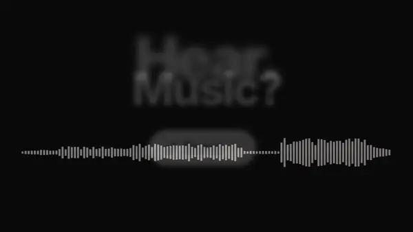
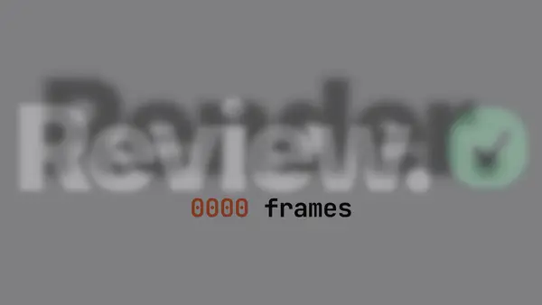
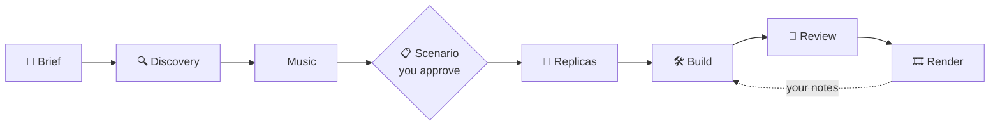

### Turn your app into a music-synced launch film, as code.

An agent skill for **Claude Code** and **Codex**. It captures your real UI, cuts it to the beat and renders a frame-exact 1080p60 MP4. No video editor, no After Effects.

[](https://code.claude.com/docs/en/skills)
[](#install-in-codex)

[](https://github.com/patryk-penczek/ship-video/actions/workflows/check.yml)
[](LICENSE)

[](#-quick-start)

<sub>This film was made with ship-video itself: one HTML page on a 120 BPM grid. [View the source](docs/hero).</sub>

## 📖 Contents

- [✨ What you get](#-what-you-get)
- [🚀 Quick start](#-quick-start)
- [🎬 How it works](#-how-it-works)
- [🔁 Iterate](#-iterate)
- [🎞️ What you can make](#️-what-you-can-make)
- [🎵 Music](#-music)
- [📏 Limits](#-limits)
- [❓ FAQ](#-faq)
- [🩺 Troubleshooting](#-troubleshooting)
- [🤝 Contributing](#-contributing)

## ✨ What you get

| | |
|---|---|
|  |  |
| **💬 Asks only what it can't find.** It reads your repo and opens every view of your running app first, then asks a few clickable questions: who it's for, how long, which music. | **🥁 Cut to the beat.** It finds the tempo, hits and drop of your track, or writes a beat for you, and lands every cut on one. The payoff hits on the drop. |
|  |  |
| **📋 You approve the plan first.** A shot-by-shot scenario (seconds, music, picture, exact copy) comes before anything is built. Changing a table costs minutes; a film costs hours. | **🎯 Your real UI, frame-exact.** Your app's own DOM and CSS, captured and animated, never mockups. Rendered frame by frame to a 1080p60 MP4, plus a WebP for READMEs. |

## 🚀 Quick start

**1. Install** in Claude Code:

```
/plugin marketplace add patryk-penczek/ship-video
/plugin install ship-video@ship-video
```

**2. Run it** in your app's repo:

```
/ship-video
```

**3. Answer, approve, watch.** It asks what it can't find in your code, shows you a scenario to approve, then renders a first cut into the film folder's `out/`.

> [!NOTE]
> The first run installs the engine into `~/.ship-video` (Chromium, GSAP, a Python audio toolkit; about 2 minutes, once). You need **Node 20+**, **ffmpeg** and **Python 3** on macOS or Linux.

### Install in Codex

```bash
npx skills add patryk-penczek/ship-video -a codex -g
```

Or copy `skills/ship-video` into `~/.agents/skills/`. Then type `$ship-video`.

> [!WARNING]
> Codex's sandbox blocks network access and writes outside your project by default, and the first-run setup needs both. Approve it when Codex asks, or run `bash ~/.agents/skills/ship-video/scripts/setup.sh` once yourself.

### Install in Claude Code without the plugin system

```bash
git clone https://github.com/patryk-penczek/ship-video.git
cp -R ship-video/skills/ship-video ~/.claude/skills/
```

## 🎬 How it works



| | step | what happens | you |
|:---:|---|---|---|
| 1 | **Brief** | reads your README, routes and components | answer a few clicks |
| 2 | **Discovery** | screenshots every view, finds the moments worth filming | glance at the product map |
| 3 | **Music** | tempo, hits and drop of your track, or a beat, or a silent grid | pick the music |
| 4 | **Scenario** | seconds, music, picture and exact copy, shot by shot | **approve it** ✋ |
| 5 | **Replicas** | captures your running app's real DOM and CSS, compares each screen | |
| 6 | **Build** | animates those screens on the beat | |
| 7 | **Review** | critiques its own frames like a director, gets a second opinion, audits | |
| 8 | **Render** | crisp 60 fps MP4, checks every cut lands on its hit | **watch it** 👀 |

Everything on screen is code: one HTML page, one paused GSAP timeline, rendered frame by frame with Playwright and ffmpeg, so the MP4 matches the preview exactly. Stopped halfway? It picks up from the files in the film folder.

**Every step in detail: [the guide](docs/guide.md).**

## 🔁 Iterate

> [!TIP]
> **The first render is a first cut.** Films get good the way edits do: you watch, say what bothers you, and it changes that and renders again in minutes. Two to four rounds are normal.


Specific notes work best:

- *Start on the search.*
- *The drop needs more punch.*
- *Show the dark mode too.*
- *Hold the end card longer.*
- *Make it 15 seconds.*

## 🎞️ What you can make

| | film | length | for |
|:---:|---|:---:|---|
| 🚀 | **Launch film** | 20–45 s | a launch post, Product Hunt, your landing page |
| 🎯 | **Feature teaser** | 10–20 s | one feature or a pricing change, for X or LinkedIn |
| 🧭 | **How-to** | 20–45 s | a help center or docs page: numbered steps, readable holds |
| 🖥️ | **Landing hero** | 10–20 s | a muted, looping clip at the top of your site |
| 📄 | **README clip** | 10–20 s | an animated WebP like the one above |

> [!TIP]
> Shorter usually wins. A clear 12-second clip of the one thing your product changes beats a 30-second tour, and the skill tells you when your material would fit a shorter film.

## 🎵 Music

| | path | what you do |
|:---:|---|---|
| 🎧 | **Your track** | point it at an audio file you made or licensed |
| 🤖 | **Suno** | paste the prompt it writes into [Suno](https://suno.com), download the best take |
| 🥁 | **Generated beat** | nothing: it writes a license-free beat from the film's own plan |
| 🔇 | **None** | nothing: cuts sit on a tempo grid, add music later |

> [!IMPORTANT]
> **Suno licensing:** songs made on Suno's **free plan can't be used commercially**, and upgrading later doesn't change that. Generate on a paid plan for anything public, and check [Suno's terms](https://suno.com). The skill asks where the film will be shown before you generate anything.

## 📏 Limits

| | |
|---|---|
| **Format** | 16:9 at 1920×1080. No vertical (Reels, Shorts). |
| **Length** | 10–45 s. Longer tracks are cut to a section. |
| **Apps** | Web apps and sites, phone-sized PWAs included. A native app only from screenshots. |
| **System** | macOS or Linux (Windows: WSL). Node 20+, ffmpeg, Python 3. |

## ❓ FAQ

#### Does my app have to be running?

It's best if it is: the skill captures the real DOM and CSS of each screen, so the film looks exactly like your app. Without a running app it rebuilds screens from your components and says which ones are approximated.

#### How long does a render take?

A crisp render takes about 2–3.5 seconds per second of film on an idle machine, so a 20 s film is about a minute. Motion blur is 3–4× slower and is offered after you've seen the crisp cut.

#### Can I edit the film myself?

Yes. A film is a folder with `index.html`, `film.js` and `film.css`. Open `index.html` to preview it (Space plays, the arrows scrub, Shift+arrow steps a frame), change anything, and render again.

#### Does anything leave my machine?

No. Capture, analysis and rendering run locally; setup downloads its dependencies once. Only the agent you're using sees your code, as it always does.

#### Is it free?

The skill is MIT and everything it installs is free. You pay only for the agent you run it in, and for Suno if you want a Suno track for public use.

## 🩺 Troubleshooting

#### The agent doesn't use the skill

Start a new session after installing (or reload plugins), then type `/ship-video` (Codex: `$ship-video`). It does not trigger for editing existing footage.

#### Setup fails installing librosa

Your Python may be too new for librosa's dependencies. Install [uv](https://docs.astral.sh/uv/) (`brew install uv`) and run `scripts/setup.sh --force` from the skill folder; uv uses Python 3.12.

#### The render uses the wrong font

Every font face must be listed in `fonts:` in `film.js` and declared with `@font-face` in `film.css`. Some bundlers ship broken `@font-face` rules: point at the font files directly.

## 🤝 Contributing

The most useful contributions come from making a real film with it. [Open an issue](https://github.com/patryk-penczek/ship-video/issues/new/choose) with what you asked for and where it went wrong, or read [CONTRIBUTING.md](CONTRIBUTING.md) to change the code.

---

[Guide](docs/guide.md) · [Contributing](CONTRIBUTING.md) · [MIT License](LICENSE)

Films you make are yours; music, fonts and assets you add keep their own licenses. The hero uses Inter and JetBrains Mono (SIL OFL) and [GSAP](https://gsap.com/standard-license).

If it made you a film you like, a ⭐ helps others find it.
